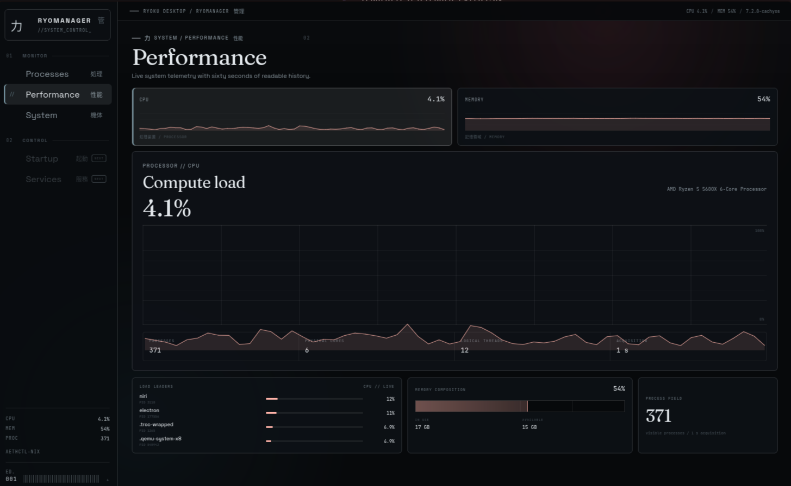
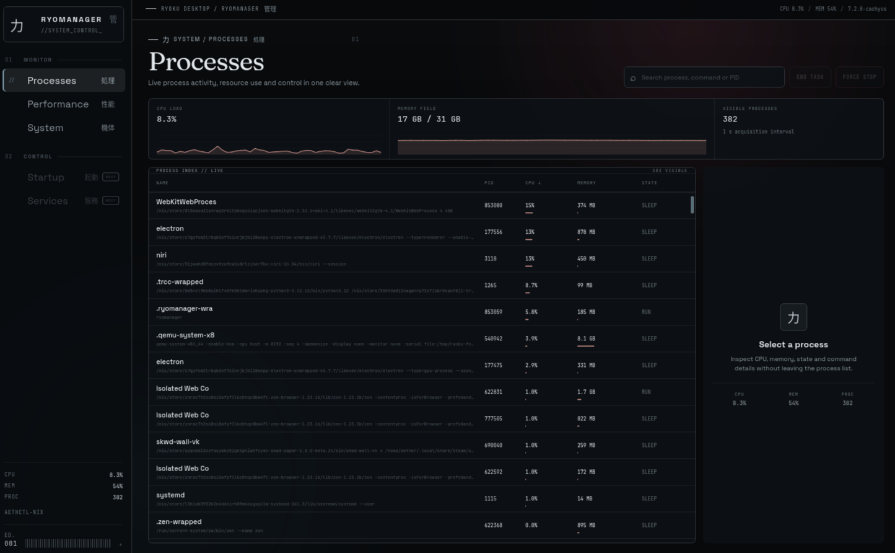
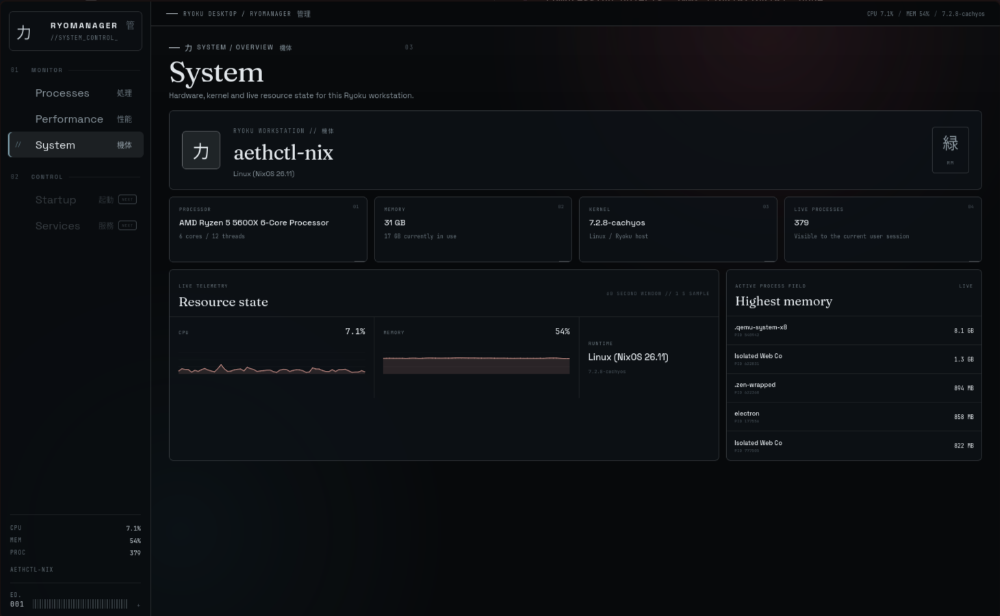

# RyoManager

<p align="center">
  
</p>

<p align="center">
  
  
</p>

## Development

RyoManager uses Wails 2, Go, Svelte 5 and Vite. The frontend lives in `frontend/`; the native Linux collector and process controls are implemented in Go.

```sh
nix develop
wails dev
```

Frontend checks:

```sh
cd frontend
npm ci
npm run check
npm run build
```

Go backend check:

```sh
go test ./...
```

Production build:

```sh
wails build
```

### Building without Nix

The flake is the shortest path, but nothing here needs it. On Arch, with
`go`, `npm`, `gtk3` and `webkit2gtk-4.1` installed, the frontend is embedded
through `//go:embed all:frontend/dist`, so building it first is the whole of
what the Wails CLI would do:

```sh
cd frontend && npm ci && npm run build && cd ..
go build -tags "desktop,production,webkit2_41" -ldflags "-s -w" -o ryomanager .
```

All three tags are needed. Leaving `desktop` and `production` out still
compiles, and the binary then exits at startup with

```
Wails applications will not build without the correct build tags.
```

which speaks about a build that has already succeeded, so it is worth knowing
before meeting it.
